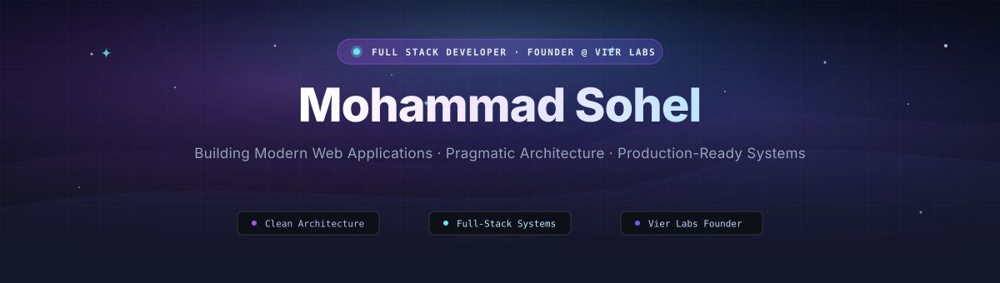

  

  
  &nbsp;
  
  &nbsp;
  
  &nbsp;
  

---

### 🌌 About Me

I am a **Full Stack Developer** and the **Founder of [Vier Labs](https://vierlabs.com/)**, dedicated to engineering modern web applications, scalable backend systems, and production-ready digital products.

- ⚙️ **Practical Engineering:** I value clean, decoupled architecture, maintainable patterns, and turning complex real-world requirements into intuitive, reliable software.
- 🌐 **Full-Stack Execution:** Experienced in building responsive, accessible interfaces (React, Next.js, TypeScript) and resilient backend services (Node.js, REST APIs, document and relational databases).
- 🚀 **Founder @ Vier Labs:** Directing product engineering from idea to deployment, building software tools centered around speed, usability, and stability.

> *"Simplicity precedes reliability. Build practical software that solves real problems with clean architecture, verified logic, and maintainable code."*

---

### 🛰️ Featured Projects

#### 01. [ProofPilot](https://github.com/m-sohel/proofpilot) — AI Agent for Payment Dispute Defense
> **Autonomous, evidence-grounded chargeback defense engine for digital merchants.**
>
> * **Deterministic Verification:** Enforces a strict evidence-first rule engine where pure code verifies all dispute facts against ground truth before any draft is generated, strictly confining LLMs to extraction and synthesis while eliminating hallucinations.
> * **Core Capabilities:** Automated dispute evidence collection, policy compliance evaluation, and economically rational accept/challenge decisioning.
> * **Stack:** `Python` • `FastAPI` • `LLM Agent Workflows` • `Deterministic Verification`
>
> 🔗 [Source Code & Documentation](https://github.com/m-sohel/proofpilot)

#### 02. [Urban Spoon](https://github.com/m-sohel/UrbanSpoon) — Full-Stack MERN Hospitality Platform
> **Production-ready restaurant portal with real-time reservation inquiries and administrative management.**
>
> * **Architecture:** End-to-end full-stack web application featuring categorized culinary menus, customer reservation inquiry pipelines, and persistent MongoDB Atlas storage.
> * **Admin Oversight:** Dedicated administrative dashboard enabling managers to inspect, filter, and track incoming guest inquiries in real time.
> * **Stack:** `React` • `Node.js` • `Express.js` • `MongoDB Atlas` • `Tailwind CSS`
>
> 🔗 [Source Code](https://github.com/m-sohel/UrbanSpoon) &nbsp;|&nbsp; 🌐 [Live Deployment](https://urbanspoon.vercel.app/)

#### 03. [JavaDSA Visual Academy](https://github.com/m-sohel/visual-javadsa) — Interactive Algorithmic Learning Engine
> **Visual-first interactive learning platform for mastering Data Structures & Algorithms in Java.**
>
> * **Dynamic Visualizers:** Interactive, backward-steppable animated visualizations of live memory allocations, pointer shifts, and call stack operations using an ELI10 teaching philosophy.
> * **Frontend Craft:** Engineered with reactive state management (Zustand), high-framerate motion animations, and responsive layout.
> * **Stack:** `React 18` • `TypeScript` • `Vite` • `Tailwind CSS` • `Framer Motion` • `Zustand`
>
> 🔗 [Source Code](https://github.com/m-sohel/visual-javadsa) &nbsp;|&nbsp; 🌐 [Live Deployment](https://visual-javadsa.vercel.app)

---

### 🛠️ Technical Stack & Tooling

<table width="100%">
  <tr>
    <td width="22%" valign="top"><strong>Frontend</strong></td>
    <td width="78%">
      
      
      
      
      
      
      
    </td>
  </tr>
  <tr>
    <td valign="top"><strong>Backend &amp; Data</strong></td>
    <td>
      
      
      
      
    </td>
  </tr>
  <tr>
    <td valign="top"><strong>Languages</strong></td>
    <td>
      
      
      
    </td>
  </tr>
  <tr>
    <td valign="top"><strong>Tools &amp; DevOps</strong></td>
    <td>
      
      
      
      
      
      
      
      
    </td>
  </tr>
</table>

---

### 📊 GitHub Activity & Analytics

  
  

  

  <em>Note: Language breakdown reflects codebase byte volume across public repositories, not developer proficiency.</em>

---

### 🌐 Connect & Collaborate

Through **[Vier Labs](https://vierlabs.com/)**, I build modern web applications and practical software solutions. I am always open to discussing technical architecture, full-stack engineering, and new software collaborations.

  
  &nbsp;
  
  &nbsp;
  

  

